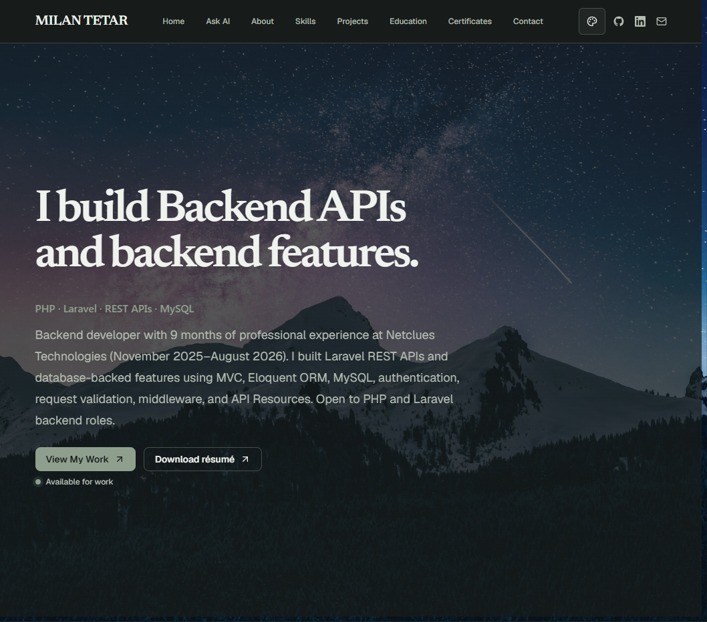

# AI Personal Portfolio CMS

[](https://github.com/milantetar/personal-portfolio/actions/workflows/ci.yml)
[](./LICENSE)

A database-driven personal portfolio and content management system built with
Laravel, Inertia, React, and TypeScript.

The public portfolio, blog, navigation, theme settings, projects, certificates,
media library, contact inbox, analytics, and AI assistant are managed through a
role-protected dashboard. Homepage content remains database-driven so the site
can be updated without changing frontend code.

## Preview



## Features

- Database-driven portfolio sections and site settings
- Projects, technical posts, certificates, and navigation management
- Media upload and assignment for portfolio branding
- Admin authentication with role-based authorization
- Contact form and dashboard inbox
- Portfolio analytics and assistant activity logs
- Optional GitHub projects integration
- Optional Gemini-powered portfolio assistant
- Optional Resend email delivery
- Inertia server-rendered pages with React
- Responsive UI with Tailwind CSS and reusable components
- Generated sitemap and robots.txt routes

## Technology

### Backend

- Laravel 13
- PHP 8.4+
- MySQL or SQLite
- Laravel Sanctum
- Spatie Laravel Data
- Spatie Laravel Permission
- Spatie Query Builder

### Frontend

- React 19
- TypeScript
- Inertia.js 3
- Vite 8
- Tailwind CSS 4
- Base UI and Lucide React
- Laravel Wayfinder

### Development tools

- Composer
- pnpm
- Pest
- Laravel Pint
- PHPStan/Larastan
- Vite Plus

## Requirements

- PHP 8.4 or newer
- Composer 2
- Node.js 22 or newer
- pnpm 10 or newer
- PHP extensions required by Laravel and the locked Composer dependencies
- A writable `storage/` and `bootstrap/cache/` directory

## Getting started

### Quick Setup (Recommended)

Clone the repository and run the automated setup command:

```bash
git clone https://github.com/your-username/personal-portfolio.git
cd personal-portfolio
composer setup
```

This installs PHP and Node dependencies, copies `.env.example`, generates the application key, creates and migrates the database, seeds starter portfolio content, links storage, and compiles the frontend.

Alternatively, you can run the interactive setup wizard:

```bash
composer install
php artisan portfolio:install
pnpm install && pnpm build
```

Then start the local servers:

```bash
php artisan serve
pnpm dev
```

The public site is available at `http://localhost:8000`.
The admin dashboard is available at `http://localhost:8000/dashboard` (default login: `admin@example.com` / `password`).

---

## 🎨 Customizing Your Portfolio (No Code Required)

Once logged into the admin dashboard at `/dashboard`, you can customize your entire portfolio:

1. **Site Settings & Branding (`/admin/site-settings`)**:
    - Change your site title, hero headline, subtitle, bio, and contact email.
    - Upload your own Avatar, Logo, Background image, and Resume PDF.
    - Set your social profiles (GitHub, LinkedIn, etc.).
    - Switch visual themes (_Midnight, Forest, Ocean, Instagram_).

2. **Sections (`/admin/sections`)**:
    - Reorder, edit, show, or hide sections (Hero, About, Skills, Experience, Projects, Certifications, Contact).

3. **Featured & GitHub Projects**:
    - Add custom curated projects via the admin dashboard.
    - Enter your GitHub username in `Site Settings` (or `.env`) to automatically pull and display your public repositories.

4. **AI Assistant (`/admin/site-settings`)**:
    - Add a free `GEMINI_API_KEY` in `.env` to enable your on-site AI assistant to answer visitor questions about your work.

---

## 🚀 Hassle-Free Production Deployment

To deploy this project to production (e.g. Railway, Render, Fly.io, DigitalOcean, VPS, or cPanel) with **minimal hassle**, you only need a handful of core environment variables.

### Minimal Required `.env` Variables

```ini
APP_NAME="My Portfolio"
APP_ENV=production
APP_DEBUG=false
APP_KEY=base64:...                      # Generate with: php artisan key:generate
APP_URL=https://your-portfolio.com

# Database (SQLite is zero-configuration and runs without a database server)
DB_CONNECTION=sqlite
DB_DATABASE=/absolute/path/to/database/database.sqlite

# Session & Cache
SESSION_DRIVER=database
CACHE_STORE=database
QUEUE_CONNECTION=database
FILESYSTEM_DISK=local
```

### What about `GITHUB_CA_BUNDLE` and `GEMINI_CA_BUNDLE`?

> [!NOTE]
> **You can completely leave `GITHUB_CA_BUNDLE` and `GEMINI_CA_BUNDLE` empty or omit them.**
>
> - **Why they exist:** On local Windows machines (e.g. WampServer/XAMPP), PHP cURL sometimes lacks a bundled `cacert.pem` trust store, causing `cURL error 60: SSL certificate problem`. These two variables allow Windows developers to manually point PHP to a local `.pem` certificate.
> - **In Production:** Linux servers, Docker containers, Railway, Render, Forge, and cloud hosts already provide up-to-date system root certificates (`ca-certificates`). cURL connects securely without needing any custom CA bundle.

### Optional Integrations Checklist

None of these are required to run the portfolio — configure them only when you want the feature:

| Variable                         | Required? | Purpose                                                                                                                   |
| -------------------------------- | --------- | ------------------------------------------------------------------------------------------------------------------------- |
| `GITHUB_USERNAME`                | Optional  | GitHub username to fetch public repositories. Can also be set directly in the Admin Dashboard.                            |
| `GITHUB_TOKEN`                   | Optional  | GitHub Personal Access Token. Raises API rate limits from 60 to 5,000 requests/hour.                                      |
| `GEMINI_API_KEY`                 | Optional  | Google AI Studio key. If left blank, the public AI assistant tab automatically hides itself.                              |
| `RESEND_API_KEY` / `MAIL_*`      | Optional  | Email service for contact form notifications and password resets. Leave unset or use `MAIL_MAILER=log` for local testing. |
| `ADMIN_EMAIL` / `ADMIN_PASSWORD` | Optional  | Initial credentials seeded by `php artisan db:seed`. You can change these inside `/dashboard`.                            |

## Content model

- `PortfolioSection` and related records drive the public homepage.
- Site settings store global identity, appearance, contact details, and media
  assignments.
- Projects and posts provide portfolio and blog content.
- Certificates and media are separate records connected through relationships.
- Navigation is managed independently for public and dashboard locations.

Useful public routes include:

```text
/
/blog
/assistant
/sitemap.xml
/robots.txt
```

## Quality checks

Run the relevant checks before opening a pull request:

```bash
pnpm check
pnpm types:check
pnpm build
composer lint:check
composer types:check
php artisan test
```

In a fresh checkout, generate the Wayfinder files before TypeScript checks:

```bash
php artisan wayfinder:generate --with-form
```

The CI workflow in `.github/workflows/ci.yml` validates frontend formatting,
TypeScript, browser and SSR builds, PHP formatting, static analysis, and tests.

## Project structure

```text
app/
  Auth/                 Authentication providers
  Console/Commands/     Application commands
  Data/                 Typed request and response data
  Http/                 Controllers, middleware, requests, and resources
  Models/               Eloquent models
  Repositories/         Data access abstractions
  Services/             Domain services
database/
  migrations/           Database schema
  seeders/              Local/bootstrap data
resources/
  js/components/        Shared, portfolio, and admin components
  js/pages/             Inertia pages
  views/                Server-rendered application shells
routes/                 Web, API, and console routes
tests/                  Pest feature and unit tests
```

## Security practices

- Keep `.env`, API keys, passwords, and database credentials private.
- Use `APP_DEBUG=false` outside local development.
- Do not place backend secrets in client-exposed environment variables.
- Review uploads and authorization rules before production use.
- Rotate credentials immediately if they are ever exposed.

## Contributing

See [CONTRIBUTING.md](./CONTRIBUTING.md) for development and pull request
guidelines. Please review the [Code of Conduct](./CODE_OF_CONDUCT.md) before
participating.

## Security

See [SECURITY.md](./SECURITY.md) for responsible vulnerability reporting.

## License

This project is licensed under the [MIT License](./LICENSE).
